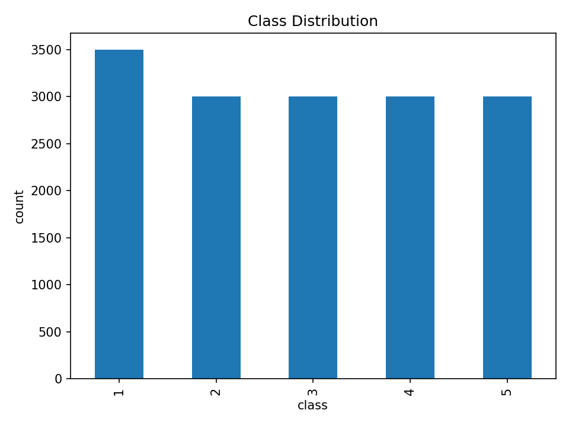
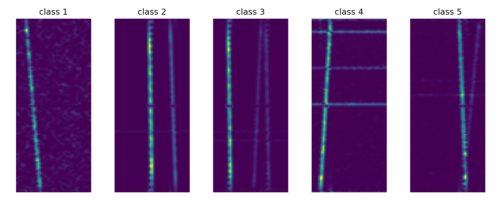
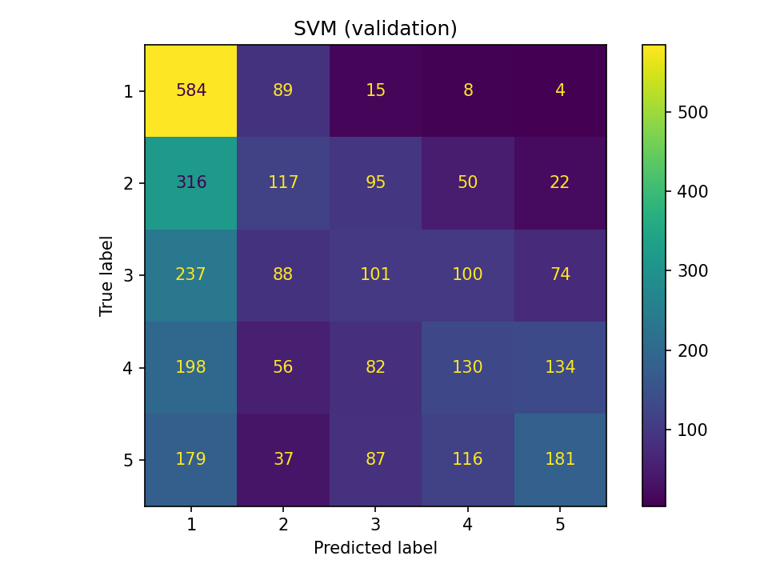
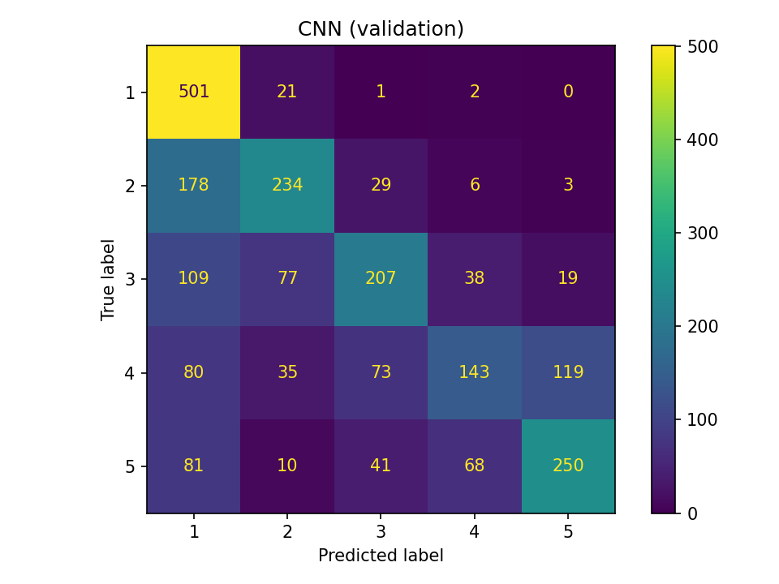
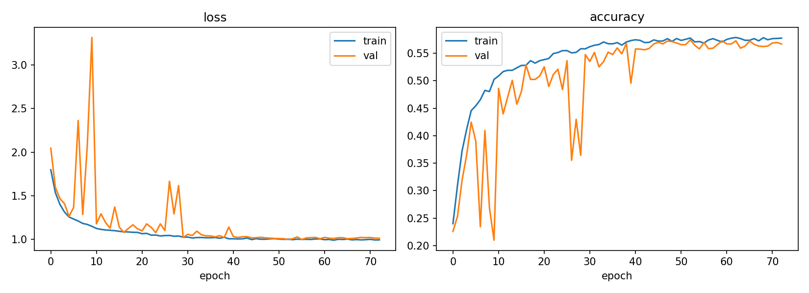

# Radio Signal Object Detection (CNN & Classical ML)

5-class classification of radio signal spectrogram images trained strictly from scratch (no external data or pre-trained weights).

- **Author:** Bulacu Daria (Group 241) — Faculty of Mathematics and Computer Science, University of Bucharest
- **Full Technical Report:** [`final/documentation.pdf`](final/documentation.pdf)

---

## Dataset & Task

- **Task:** Classify `.png` spectrogram images (`viridis` colormap) into one of **5 classes** (`1`–`5`).
- **Splits:** 15,500 training images (`data/train.csv`) and 5,500 test images (`data/test.csv`).

| Class Distribution | Samples Per Class |
| :---: | :---: |
|  |  |

---

## Repository Structure

```text
Radio-Signal-Obj-Detection-CNN/
├── data/                   # Dataset (train/, test/, train.csv, test.csv)
├── final/                  # Final submission scripts & full report
│   ├── documentation.pdf   # Detailed methodology & experiments report
│   ├── model1.py           # Approach 1: HOG + PCA + RBF SVM
│   └── model2.py           # Approach 2: Custom VGG-style CNN & Ensembles
├── models/                 # Saved model checkpoints (.keras, .joblib)
├── nb/                     # Exploratory & training Jupyter notebooks
├── res/                    # Plots, confusion matrices, HP tables, submissions
└── task.md                 # Competition guidelines
```

---

## Approaches Summary

Both pipelines convert the 4-channel RGBA `viridis` images into single-channel grayscale (`128×64`), preserving signal luminance while reducing input size by $4\times$.

### 1. Classical ML: HOG + PCA + RBF SVM ([`final/model1.py`](final/model1.py))
- **Pipeline:** HOG feature extraction $\rightarrow$ `StandardScaler` $\rightarrow$ `PCA` (150 components) $\rightarrow$ RBF-kernel SVM.
- **Tuning:** 3-fold grid search over `C ∈ {1, 10, 100}` and `gamma ∈ {'scale', 0.001, 0.01}` (best: `C=10, gamma='scale'`).
- **Result:** ~`35.9%` validation accuracy. Heavy spectrogram background noise and fine column-wise patterns caused hand-crafted gradient histograms to underperform.

### 2. Deep Learning: Custom VGG-Style CNN ([`final/model2.py`](final/model2.py))
- **Architecture:** 3 convolutional blocks with filter widths `(64, 128, 256)` (each with two `3×3` `Conv2D` + `BatchNorm` + `ReLU`, followed by `2×2` `MaxPooling` and `Dropout(0.25)`), `GlobalAveragePooling2D`, a `128`-unit `Dense` head (`Dropout(0.5)`), and a 5-class `Softmax` output.
- **Augmentation & Training:** In-graph `RandomTranslation(0.05)` and `RandomContrast(0.1)`; trained with `Adam (lr=1e-3)`, `EarlyStopping`, and `ReduceLROnPlateau`.
- **Ensembling:** Soft-voting across a **3-seed ensemble** and a **5-fold stratified cross-validation ensemble** to reduce variance and boost test performance.

| CNN Hyperparameter Variant | Validation Acc | Learning Rate | Optimizer |
| :--- | :---: | :---: | :---: |
| **`baseline`** (`(64, 128, 256)` filters, `dropout=0.25/0.5`) | **0.7037** | `1e-3` | Adam |
| **`sgd_momentum`** (`momentum=0.9`) | 0.4551 | `1e-2` | SGD |
| **`no_dropout`** (`dropout=0.0`) | 0.4245 | `1e-3` | Adam |
| **`higher_lr`** | 0.4047 | `1e-2` | Adam |
| **`smaller_model`** (`(16, 32, 64)` filters) | 0.3118 | `1e-3` | Adam |
| **`lower_lr`** | 0.2589 | `1e-4` | Adam |

### Results & Diagnostics

| SVM Confusion Matrix | CNN Confusion Matrix |
| :---: | :---: |
|  |  |



---

## Usage

### 1. Install Dependencies
```bash
pip install numpy pandas matplotlib pillow scikit-image scikit-learn tensorflow joblib
```

### 2. Run Pipelines
Ensure the `data/` folder is located in the working directory alongside the scripts:

```bash
# Train & evaluate Classical ML model (HOG + PCA + SVM)
python final/model1.py

# Train & evaluate Custom CNN, run ablations, and generate ensemble submissions
python final/model2.py
```

For full architectural rationale, preprocessing debugging notes, and experimental analysis, see [`final/documentation.pdf`](final/documentation.pdf).
